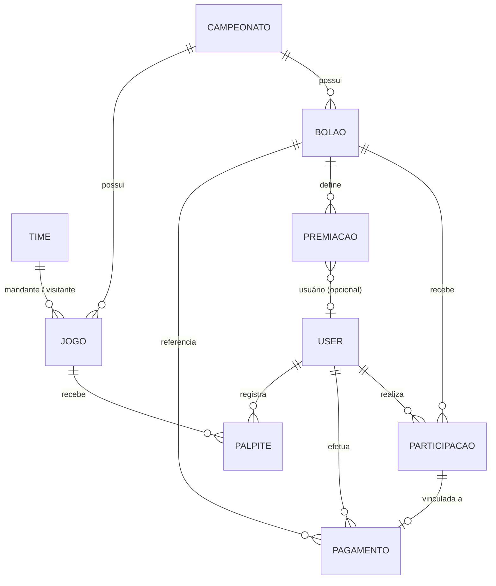

# Palpitou API


API REST robusta desenvolvida em **Java 17** e **Spring Boot 4.1.0** para gerenciamento de plataformas de **bolões de futebol**, com foco inicial no Campeonato Brasileiro e no Campeonato Paulista. 

O sistema modela o ciclo completo de um produto real: cadastro de campeonatos, times, partidas, criação de bolões, inscrições de participantes com comprovação de pagamento PIX, envio de palpites de placar, motor automatizado de pontuação e ranking, além de um dashboard administrativo consolidado.

---

## Índice

- [Visão Geral e Objetivo](#visão-geral-e-objetivo)
- [Problema que o Projeto Resolve](#problema-que-o-projeto-resolve)
- [Principais Funcionalidades](#principais-funcionalidades)
- [Stack Tecnológica](#stack-tecnológica)
- [Arquitetura e Organização do Backend (DDD)](#arquitetura-e-organização-do-backend-ddd)
- [Regras de Negócio e Estados](#regras-de-negócio-e-estados)
- [Sistema de Pontuação e Ranking](#sistema-de-pontuação-e-ranking)
- [Participações e Pagamentos (PIX)](#participações-e-pagamentos-pix)
- [Dashboard Administrativo](#dashboard-administrativo)
- [Tratamento de Exceções](#tratamento-de-exceções)
- [Segurança](#segurança)
- [Endpoints da API](#endpoints-da-api)
- [Documentação da API (Swagger)](#documentação-da-api-swagger)
- [Banco de Dados](#banco-de-dados)
- [Como Executar](#como-executar)
- [Estratégia de Testes](#estratégia-de-testes)
- [Integrações Externas (Planejamento API-Football)](#integrações-externas-planejamento-api-football)
- [Metodologia de Desenvolvimento com Inteligência Artificial](#metodologia-de-desenvolvimento-com-inteligência-artificial)
- [Funcionalidades Concluídas e Roadmap](#funcionalidades-concluídas-e-roadmap)
- [Autor](#autor)

---

## Visão Geral e Objetivo

O **Palpitou** nasceu com o objetivo de estruturar um backend profissional, testável, seguro e preparado para integração com front-ends (Web/Mobile) e serviços externos de futebol. Diferente de um CRUD acadêmico isolado, o projeto simula um ambiente de produção onde cada transação financeira (PIX), validação temporal (prazo de palpites antes da partida) e cálculo pontual impactam diretamente o engajamento e a competitividade dos participantes.

---

## Problema que o Projeto Resolve

Tradicionalmente, bolões de futebol em grupos de amigos, empresas ou bolões amadores são geridos de forma manual e descentralizada em planilhas eletrônicas ou aplicativos de mensagens. Isso gera:
- **Erros humanos** no cálculo de pontos e apuração de resultados.
- **Falta de transparência** na comprovação de pagamentos e inscrições.
- **Dificuldade de escala** para gerenciar múltiplos campeonatos, rodadas e bolões simultaneamente.
- **Ausência de métricas consolidadas** (faturamento, engajamento e status de pagamentos).

O **Palpitou API** resolve essas dores centralizando a governança do bolão, automatizando o motor de regras de pontuação, auditando pagamentos e fornecendo contratos REST claros e documentados.

---

## Principais Funcionalidades

- **Gestão de Campeonatos e Partidas:** Cadastro flexível de competições (temporadas, status global) e jogos vinculados a times mandantes e visitantes.
- **Criação de Bolões:** Configuração de bolões por campeonato, definindo valor de inscrição, período de vigência e premiações.
- **Inscrição com Pagamento PIX:** Registro de pagamentos associados a comprovantes textuais e validação de aprovação prévia para efetivação da participação.
- **Envio de Palpites:** Registro de previsões de placares (gols mandante e visitante) com validação de prazo (proibido palpitar após o início do jogo).
- **Motor de Pontuação e Ranking:** Cálculo automatizado de pontos por partida (placar exato, vencedor, gols) e geração de ranking por rodada.
- **Dashboard Administrativo:** Consultas agregadas no banco de dados para faturamento total, pagamentos pendentes, aprovados e recusados, e métricas por bolão.

---

## Stack Tecnológica

| Categoria | Tecnologia | Versão / Detalhes |
| --- | --- | --- |
| Linguagem | Java | 17 (OpenJDK) |
| Framework | Spring Boot | 4.1.0 |
| API REST | Spring Web MVC | Padrão RESTful |
| Persistência | Spring Data JPA / Hibernate | Mapeamento relacional ORM |
| Validação | Jakarta Bean Validation | Anotações `@NotNull`, `@NotBlank`, `@Email` |
| Segurança | Spring Security | Configuração inicial de segurança |
| Banco de Dados | H2 Database | Em memória (desenvolvimento e testes) |
| Documentação | Springdoc OpenAPI / Swagger UI | v2.8.9 (`/swagger-ui.html`) |
| Produtividade | Lombok | Redução de boilerplate (`@Getter`, `@Setter`, etc.) |
| Build / Dependências | Maven | Maven Wrapper inclusos (`mvnw` / `mvnw.cmd`) |
| Versionamento | Git / GitHub | Controle de versão |

---

## Arquitetura e Organização do Backend (DDD)

A aplicação adota uma arquitetura em camadas bem definida, promovendo a separação de responsabilidades inspirada em princípios de **Domain-Driven Design (DDD)** e arquitetura limpa:

```text
Controller → Service → Repository → Database  
    ↑           ↑  
   DTO         Mapper / Entity  
```

| Camada | Pacote | Responsabilidade |
| --- | --- | --- |
| **Controller** | `br.com.palpitou.controller` | Expõe os endpoints REST, recebe DTOs de entrada e devolve DTOs de resposta. Delega o processamento aos services. |
| **Service** | `br.com.palpitou.service` | Concentra as regras de negócio, validações, motor de pontuação e agregações. |
| **Repository** | `br.com.palpitou.repository` | Interfaces Spring Data JPA (`JpaRepository`), contendo consultas derivadas e JPQL customizadas. |
| **DTO** | `br.com.palpitou.dto` | Contratos de entrada (`request`), saída (`response`), atualização (`putRequest`, `putResponse`) e relatórios (`Dashboard`). |
| **Mapper** | `br.com.palpitou.mapper` | Classes `@Component` dedicadas à conversão manual entre entidades e DTOs, mantendo controllers e services limpos. |
| **Entity** | `br.com.palpitou.entity` | Modelagem relacional do domínio com anotações JPA/Hibernate. |
| **Exception** | `br.com.palpitou.exception` | Tratamento centralizado (`GlobalExceptionHandler`, `BusinessRuleException`, `ResourceNotFoundException`). |
| **Security** | `br.com.palpitou.security` | Configuração de segurança com Spring Security (`SecurityConfig`). |

### Modelo de Domínio (ERD)



---

## Regras de Negócio e Estados

As regras de negócio centrais são validadas na camada de serviço (`Service`), lançando `BusinessRuleException` capturada pelo `GlobalExceptionHandler` (retornando `409 Conflict`):

| Contexto | Regra de Negócio | HTTP Status em Violação |
| --- | --- | --- |
| **Participação** | Um usuário não pode se inscrever duas vezes no mesmo bolão. | `409 Conflict` |
| **Participação** | A criação de participação exige um pagamento com status `APROVADO`. | `409 Conflict` |
| **Participação** | Bolões com data de início já expirada não aceitam novas inscrições. | `409 Conflict` |
| **Palpite** | O usuário só pode registrar um palpite por jogo. | `409 Conflict` |
| **Palpite** | Não é permitido enviar ou alterar palpites após o início da partida. | `409 Conflict` |
| **Bolão / Jogo** | Proibido cadastrar bolões ou jogos vinculados a campeonatos finalizados (`FINALIZADA`). | `409 Conflict` |
| **Partida** | O time mandante e o visitante não podem ser o mesmo. | `409 Conflict` |

### Estados e Enums

- **`StatusPagamento`**: `PENDENTE`, `APROVADO`, `RECUSADO`
- **`StatusParticipacao`**: `PENDENTE`, `APROVADA`, `REJEITADA`
- **`StatusGlobal`** (Campeonato, Bolão, Jogo): `ABERTA`, `EM_ANDAMENTO`, `FINALIZADA`
- **`Role`**: `ADMIN`, `USER`

---

## Sistema de Pontuação e Ranking

O motor de pontuação implementado em `PontuacaoService` avalia o palpite do usuário comparando-o com o placar oficial da partida:

| Situação do Palpite | Pontos |
| --- | --- |
| **Placar exato** (gols mandante e visitante corretos) | **10** |
| **Vencedor correto E gols do time vencedor corretos** | **7** |
| **Vencedor correto** (mandante ou visitante) | **5** |
| **Empate previsto corretamente** (placar diferente do exato) | **5** |
| **Resultado incorreto** | **0** |

O serviço também oferece métodos para filtragem de palpites por rodada, soma de pontos por participante e geração de ranking ordenado (`RankingResponse`).

---

## Participações e Pagamentos (PIX)

O fluxo financeiro e de adesão opera em etapas auditáveis:
1. O usuário registra um pagamento informando valor, nome do pagador PIX e comprovante textual (`/pagamentos` — status inicial `PENDENTE`).
2. O administrador aprova ou recusa o pagamento via `PUT /pagamentos/{id}`.
3. Com o pagamento `APROVADO`, o usuário cria sua participação no bolão (`/participacoes`).

---

## Dashboard Administrativo

O `DashboardService` executa consultas de agregação otimizadas diretamente no banco de dados (evitando carregar entidades em memória):
- **Métricas Gerais (`GET /dashboard`):** Total de bolões, participantes com participações aprovadas, contagem de pagamentos por status (`PENDENTE`, `APROVADO`, `RECUSADO`) e faturamento total (soma dos pagamentos aprovados).
- **Métricas por Bolão (`GET /dashboard/boloes`):** Visão detalhada por grupo de bolão.

---

## Tratamento de Exceções

Centralizado no `GlobalExceptionHandler` (`@RestControllerAdvice`):
- `ResourceNotFoundException` → `404 Not Found`
- `BusinessRuleException` → `409 Conflict`

Mantém os services limpos e padroniza as respostas de erro da API.

---

## Segurança

Atualmente, o projeto conta com a configuração estrutural do Spring Security (`SecurityConfig`) desativando CSRF. As rotas encontram-se abertas (`permitAll()`) para agilizar o desenvolvimento local e os testes via Swagger. 
> **Nota de Segurança:** A autenticação JWT, a criptografia de senhas com `BCrypt` e o controle de acesso por perfis (`Role`) constam no roadmap de produção.

---

## Endpoints da API

| Recurso | Base Path | Operações Disponíveis |
| --- | --- | --- |
| Campeonatos | `/campeonatos` | `GET`, `GET /{id}`, `POST`, `PUT /{id}`, `DELETE /{id}` |
| Bolões | `/boloes` | `GET`, `GET /{id}`, `POST`, `PUT /{id}`, `DELETE /{id}` |
| Jogos | `/jogos` | `GET`, `GET /{id}`, `POST`, `PUT /{id}`, `DELETE /{id}` |
| Times | `/times` | `GET`, `GET /{id}`, `POST`, `PUT /{id}`, `DELETE /{id}` |
| Usuários | `/users` | `GET`, `GET /{id}`, `POST`, `PUT /{id}/Me`, `PUT /{id}/Role`, `DELETE /{id}` |
| Pagamentos | `/pagamentos` | `GET`, `GET /{id}`, `POST`, `PUT /{id}`, `DELETE /{id}` |
| Participações | `/participacoes` | `GET`, `GET /{id}`, `POST`, `PUT /{id}`, `DELETE /{id}` |
| Palpites | `/palpites` | `GET`, `GET /{id}`, `POST`, `PUT /{id}`, `DELETE /{id}` |
| Premiações | `/premiacao` | `GET`, `GET /{id}`, `POST`, `DELETE /{id}` |
| Dashboard | `/dashboard` | `GET`, `GET /boloes` |

---

## Documentação da API (Swagger)

Com a aplicação rodando, acesse a documentação interativa OpenAPI/Swagger UI:
- **Swagger UI:** <http://localhost:8080/swagger-ui.html>
- **OpenAPI JSON:** <http://localhost:8080/v3/api-docs>

---

## Banco de Dados

Utiliza **H2 Database** em memória (`jdbc:h2:mem:palpitou`).
- **Console H2:** <http://localhost:8080/h2-console>
- **Credenciais:** Usuário `sa` / senha vazia.
- **DDL Strategy:** `spring.jpa.hibernate.ddl-auto=update`

---

## Como Executar

### Pré-requisitos
- Java 17 (JDK)
- Git

### 1. Clonar o Repositório
```bash
git clone https://github.com/juniorsousa53339-svg/palpitou-api.git
cd palpitou-api
```

### 2. Executar os Testes Unitários
```bash
# Linux / macOS
./mvnw test

# Windows (PowerShell / CMD)
.\mvnw.cmd test
```

### 3. Executar a Aplicação
```bash
# Linux / macOS
./mvnw spring-boot:run

# Windows (PowerShell / CMD)
.\mvnw.cmd spring-boot:run
```

### 4. Acessar a Documentação
Abra <http://localhost:8080/swagger-ui.html> no navegador.

---

## Estratégia de Testes

O projeto possui suíte de testes unitários desenvolvida com **JUnit 5** e **Mockito**, cobrindo os principais serviços de domínio:
- `BolaoServiceTest`
- `DashboardServiceTest`
- `PagamentoServiceTest`
- `PalpiteServiceTest`
- `ParticipacaoServiceTest`
- `PontuacaoServiceTest` (incluindo simulação de pontuações exatas, parciais e ranking de rodada)
- `ApiApplicationTests` (teste de carga de contexto Spring)

---

## Integrações Externas (Planejamento API-Football)

O projeto possui especificação técnica documentada (`docs/API_INTEGRATION_REFERENCE.md`) para futura integração com a **API-Football (API-Sports)**. A arquitetura prevê um pacote isolado `integration` contendo:
1. **`integration.client`**: Clientes HTTP utilizando o `RestClient` do Spring Boot com autenticação via cabeçalho (`x-apisports-key`).
2. **`integration.dto`**: Records para desserialização dos JSONs externos.
3. **`integration.service`**: Serviços de sincronização idempotente de campeonatos, times e partidas, disparando o recálculo automático de pontuações e rankings ao finalizar partidas (`FT`).

---

## Metodologia de Desenvolvimento com Inteligência Artificial

Este projeto foi construído sob uma abordagem avançada de **Engenharia de Software Assistida por IA**, demonstrando maturidade na aplicação de ferramentas modernas sem abrir mão da autoria, rigor técnico e aprendizado contínuo do desenvolvedor.

### 1. Spec-Driven Development (SDD) e Documentação Viva
O desenvolvimento seguiu rigorosamente especificações técnicas prévias e documentação estruturada em `docs/` (`PROJECT_CONTEXT.md`, `ROADMAP.md`, `DECISIONS.md`, `API_INTEGRATION_REFERENCE.md`). Nenhum código foi escrito sem alinhamento prévio ao escopo e arquitetura definidos.

### 2. Arquitetura Multiagente Especializada
Utilização de agentes especializados configurados no ecossistema do **Claude Code** para suportar diferentes dimensões do ciclo de desenvolvimento:
- **Java Mentor (`java-mentor`):** Orientação didática sobre conceitos arquiteturais, padrões Spring Boot e decisões de design incremental.
- **Code Reviewer (`code-reviewer`):** Auditoria de código focada em segurança, corretude, integridade de dados JPA/transações e princípios SOLID.
- **Test Engineer (`test-engineer`):** Concepção e validação de testes unitários com JUnit 5 e Mockito.

### 3. Engenharia de Contexto e Governança
- **Contexto Modular (`CLAUDE.md` e regras em `.claude/rules/`):** Garantia de que todas as interações com IAs respeitassem estritamente os padrões de arquitetura em camadas, validação de entradas, tratamento global de exceções e proteção do repositório.
- **Papel do Desenvolvedor:** O desenvolvedor humano permaneceu integralmente no comando — concebendo os requisitos, avaliando trade-offs arquiteturais, revisando as implementações propostas e conduzindo as decisões técnicas finais.

---

## Funcionalidades Concluídas e Roadmap

### ✅ Concluído
- [x] Modelagem completa do domínio (9 entidades relacionais)
- [x] DTOs segmentados (Request, Response, PutRequest, PutResponse, Dashboard)
- [x] Mappers dedicados para conversão de entidades
- [x] Repositórios Spring Data JPA com consultas customizadas
- [x] Services com regras de negócio e validações defensivas
- [x] Controllers REST para todos os recursos
- [x] Motor de pontuação e ranking por rodada
- [x] Dashboard analítico e faturamento via agregações SQL
- [x] Tratamento global de exceções (`GlobalExceptionHandler`)
- [x] Documentação OpenAPI / Swagger UI
- [x] Testes unitários com JUnit 5 e Mockito

### 🔄 Em Andamento / Próximos Passos
- [ ] Endpoints REST dedicados para consulta de ranking
- [ ] Autenticação e autorização robusta (Spring Security + JWT + BCrypt)
- [ ] Tratamento dedicado para erros de validação (`MethodArgumentNotValidException`)
- [ ] Apuração automática de premiações
- [ ] Persistência em banco relacional de produção (PostgreSQL)
- [ ] Integração com API externa de futebol (API-Football)
- [ ] Containerização com Docker e Docker Compose
- [ ] Desenvolvimento de front-end (Angular)

---

## Autor

Desenvolvido por **Luciano Junior**

[LinkedIn](https://www.linkedin.com/in/lucianosousa001/) • [GitHub](https://github.com/juniorsousa53339-svg)
